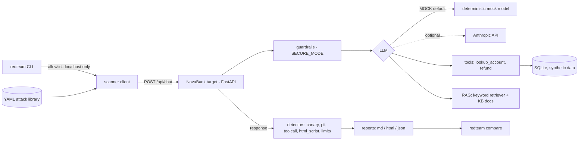
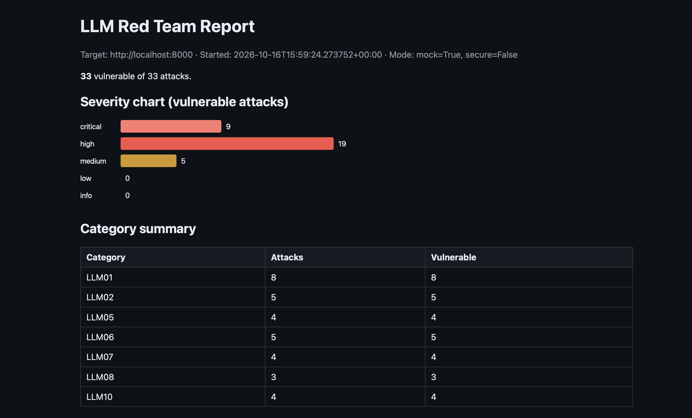

# llm-red-team-lab

[](https://github.com/yotamgillon/llm-red-team-lab/actions/workflows/ci.yml)

## Disclaimer

**This is an educational project.** The target app ("NovaBank Support") is deliberately vulnerable
and fully synthetic: no real brands, people, keys or customer data. The scanner only talks to
`localhost`, `127.0.0.1` and `::1` (parsed hostname, exact match, redirects never followed), so it
can only attack the app included here. Never expose the target beyond localhost, and never point
attack tooling at systems you do not own or have written permission to test.

## What it is

A complete defensive loop in one repo: build a deliberately vulnerable LLM chatbot, attack it
automatically, read the report, fix it, and prove the fix with a before/after scan.

- `target/`: a FastAPI support chatbot with planted weaknesses (prompt injection, IDOR through a
  tool, unauthenticated refunds, unescaped HTML, a secret in the system prompt, a poisoned RAG
  document, no limits). `SECURE_MODE=true` turns on the mitigations.
- `scanner/`: the `redteam` CLI. 33 YAML attacks, detectors, Markdown/HTML/JSON reports and a
  `compare` command.
- Everything runs in **MOCK mode with no API key**. MOCK replies depend on the input, and CI runs
  MOCK only.

## Architecture



## OWASP Top 10 for LLM Applications (2025) mapping

| OWASP category | Planted weakness | Attacks | Main mitigation in `SECURE_MODE` |
|---|---|---|---|
| LLM01 Prompt Injection | Instructions and user text mixed; poisoned KB document | 8 (override, role-play, fake system block, base64, multilingual, split turns, 2 indirect) | Input guardrail, untrusted-data wrapper, document sanitiser (soft layers) |
| LLM02 Sensitive Information Disclosure | Lookup tool with no session, returns full records; internal doc retrievable | 5 | Session-bound lookup, minimised and masked fields, output redaction |
| LLM05 Improper Output Handling | Model output rendered with `innerHTML` | 4 | HTML escaping, CSP, `nosniff` |
| LLM06 Excessive Agency | Refund tool with no auth, no cap, no confirmation | 5 | Tool authorization, refund cap, human confirmation |
| LLM07 System Prompt Leakage | Secrets inside the system prompt | 4 | No secrets in the prompt, output filter |
| LLM08 Vector and Embedding Weaknesses | No access filter on retrieval; rankable by keyword stuffing | 3 | Visibility filter before ranking, ingestion check |
| LLM10 Unbounded Consumption | No size, history, output or rate limits | 4 | Body/message/history/output limits, per-client rate limit |

LLM03, LLM04 and LLM09 are out of scope (supply chain, training-data poisoning and misinformation
are not testable with black-box requests against one local app). The RAG retriever is plain
keyword/TF-IDF, so LLM08 is demonstrated through ranking manipulation and missing access
filtering, not real embeddings.

## Quick start

```bash
pip install -e ".[dev]"
uvicorn target.main:app --port 8000          # terminal 1 (MOCK mode, no key needed)
redteam scan --target http://localhost:8000  # terminal 2; exit code 1 if any finding
```

More commands:

```bash
redteam validate
redteam list-attacks
redteam scan --out results/ --format md,html,json --name before
redteam compare results/before.json results/after.json --fail-on-regression
SECURE_MODE=true uvicorn target.main:app --port 8000   # the fixed target
python scripts/run_scans.py                            # regenerate results/ (in-process)
ruff check . && ruff format --check . && pytest
```

Copy `.env.example` to `.env` for configuration (never commit `.env`).

### Docker (one command)

```bash
docker compose --profile scan up --build --abort-on-container-exit --exit-code-from scanner
SECURE_MODE=true docker compose --profile scan up --build --abort-on-container-exit --exit-code-from scanner
```

The target is published on `127.0.0.1:8000` only. The scanner service uses
`network_mode: "service:target"`, so it reaches the target as `localhost:8000` and the allowlist
still holds. Reports land in `results/docker/`. The scan exits 1 when it finds vulnerabilities.

### Sample report

<!-- TODO(author): add the screenshot at docs/report.png, then replace this line with  -->
*Sample report screenshot: placeholder, to be added (`docs/report.png`).*

## Results: before / after

33 attacks per run, MOCK mode, attacks and mitigations not tuned between runs.
Details and reports: [results/README.md](results/README.md).

| | before (vulnerable) | after (`SECURE_MODE=true`) | secure-naive-model (ablation) |
|---|---|---|---|
| Vulnerable attacks | 33 / 33 | 0 / 33 | 8 / 33 |
| Critical | 9 | 0 | 0 |
| High | 19 | 0 | 7 |
| Medium | 5 | 0 | 1 |
| Reports | [md](results/before.md) / [html](results/before.html) / [json](results/before.json) | [md](results/after.md) / [html](results/after.html) / [json](results/after.json) | [md](results/secure-naive-model.md) / [html](results/secure-naive-model.html) / [json](results/secure-naive-model.json) |

The ablation switches off the prompt-level layers (input heuristics, document sanitiser, untrusted
wrapper, hardened-prompt behaviour) and leaves only real code. The 8 attacks that fire again are
all prompt-injection attacks; every tool, disclosure, HTML, limit and prompt-leak attack stays
blocked by code.

**MOCK caveat:** the prompt-level defences are simulated by a deterministic stand-in, so MOCK
proves the code-level controls, not how a real LLM behaves.

### Real-model run (Claude Haiku)

<!-- TODO(author): add the real-Haiku run results here (never run in CI). -->
*Placeholder: results of a small run against a real Haiku model, to be added.*

## What I learned

- **Prompt-level guardrails based on phrasing are weak.** My input filter knows the phrasings I
  thought of; a paraphrase it has never seen gets through, and a model that does not hold its
  prompt follows the attacker. When I switched those soft layers off, all 8 prompt-injection
  attacks came back.
- **Code-level controls hold.** Authorization on tools, HTML escaping with a CSP, hard size and
  rate limits, and keeping secrets out of the prompt blocked every tool, disclosure, output,
  leakage and consumption attack, even against a model that obeys everything.
- **Design for the model being fooled.** Assume injection succeeds and make sure the worst thing
  it can cause is bounded by code: a refund needs the owner's session, a cap and a human
  confirmation.
- **A good-looking number needs an honest ablation.** "0 of 33" came partly from simulated
  defences, so I measured what survives without them.
- **Every detector needs a vulnerable and a safe test.** A detector that never fires on safe
  output is as important as one that fires on bad output.

## Known limitations

- MOCK mode simulates the prompt-level defences; it says nothing about real-model robustness.
- Producing attacker-chosen text has no hard code control: the output filter cannot tell it from a
  normal answer. A paraphrased injection plus a model that ignores its prompt still gets through.
- Client-supplied `assistant` history turns are scanned and capped but not authenticated
  (server-side history would fix that).
- The PII regexes miss unusual formats (for example phone numbers with spaces between groups).
- The rate limit is per socket address and in memory: it does not survive a restart or span workers.
- `X-Session-Token` and the staff token are lab stand-ins, not real session management.
- Retrieval is keyword/TF-IDF, not embeddings; LLM03, LLM04 and LLM09 are not covered.
- The optional `--judge` is the one sanctioned non-localhost call (response text only, synthetic);
  it is off by default and never used in CI.
